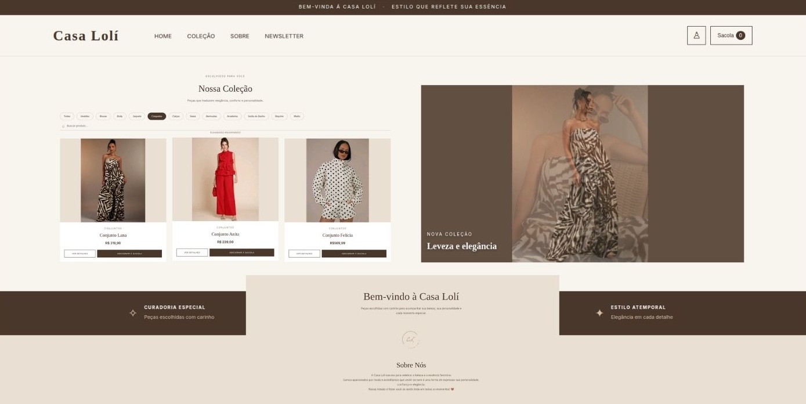

<h1 align="center"> Casa Lolí </h1>

Este projeto foi desenvolvido com fins educacionais, como parte das atividades acadêmicas do curso de Ciência da Computação, com o objetivo de aplicar e aprimorar conhecimentos em desenvolvimento web e tecnologias 
utilizadas na construção de interfaces digitais.

  <a href="#-tecnologias">Tecnologias</a>&nbsp;&nbsp;&nbsp;|&nbsp;&nbsp;&nbsp;
  <a href="#-projeto">Projeto</a>&nbsp;&nbsp;&nbsp;|&nbsp;&nbsp;&nbsp;
  <a href="#memo-licença">Licença</a>

  

  

## 🚀 Tecnologias

Esse projeto foi desenvolvido com as seguintes tecnologias:

- HTML e CSS
- JavaScript
- Git e Github

## 💻 Projeto

**Casa Lolí** é um projeto de loja virtual de moda feminina, desenvolvido com o propósito de apresentar roupas e coleções de forma moderna, intuitiva e elegante. O site oferece uma experiência de navegação que permite explorar produtos, visualizar detalhes das peças e adicionar itens ao carrinho de compras.

O projeto foi desenvolvido como atividade acadêmica, com foco na aplicação prática de conceitos de desenvolvimento web, design de interfaces e experiência do usuário (UX/UI).

- [Acesse o projeto finalizado, online](https://lailapereira.github.io/Casa-Loli/)

## 🚧 Próximas etapas

- [ ] Implementar o cadastro e funcionamento da newsletter.
- [X] Implementar funcionalidades do perfil do usuário.
- [X] Desenvolver sistema de login.
- [X] Desenvolver sistema de criação de conta (cadastro).
- [ ] Implementar validações dos formulários.
- [ ] Aprimorar funcionalidades e interações do site.
- [ ] Realizar testes e ajustes finais de responsividade.

## :memo: Licença

Esse projeto está sob a licença MIT.

---

Feito com ♥ by Laila Pereira
